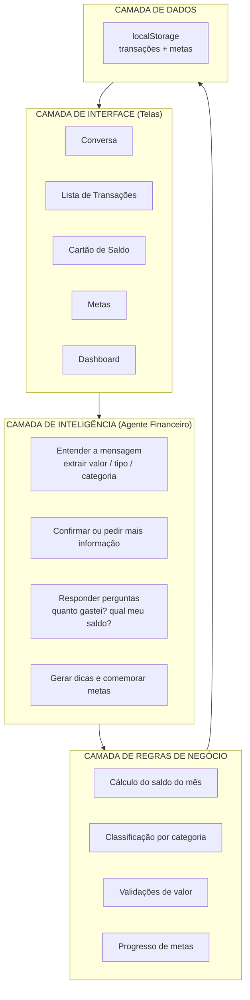
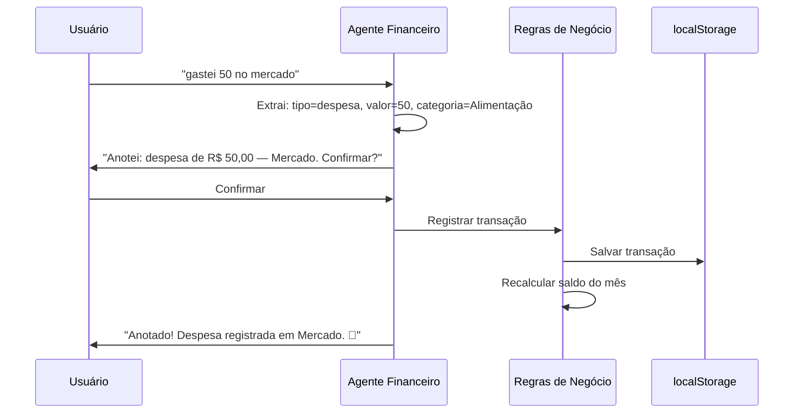
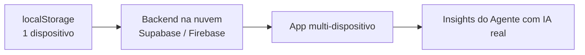

# 🏗️ Arquitetura do Projeto — Minhas Finanças

Este documento descreve a arquitetura do repositório e do app **Minhas Finanças**, construído com Vibe Coding (sem código manual).

---

## 1. Arquitetura do Repositório

O repositório é um **guia executável**: cada arquivo tem um papel no fluxo de vibe coding.

```
📁 lab-vibe-coding-app-financas_2026
 ├── README.md          ← Guia principal: conceito, regras de ouro, etapas e checklists
 ├── AGENTS.md          ← Contexto para ferramentas de IA (Copilot, Lovable, agentes)
 ├── PRD.md             ← Contexto persistente: requisitos do produto (briefing da IA)
 ├── ARCHITECTURE.md    ← Este documento: arquitetura do repositório e do app
 ├── prompts/           ← Prompts prontos, uma fase por arquivo
 │   ├── fase-0-base.md         → UI base (título, cartão de saldo, chat)
 │   ├── fase-1-chat.md         → Registro de transações via conversa
 │   ├── fase-2-classificacao.md→ Classificação automática + lista organizada
 │   ├── fase-3-saldo.md        → Cálculos do saldo e resumo do mês
 │   ├── fase-4-agente.md       → Metas e dicas do Agente Financeiro
 │   ├── fase-5-dashboard.md    → Relatórios e gráficos
 │   └── fase-6-persistencia.md → Persistência, validações e polimento
 ├── LICENSE           ← MIT © 2026 Pedro Zeferino da Silva
 └── .gitignore        ← Arquivos ignorados no versionamento
```

**Fluxo de uso dos arquivos:**

```mermaid
flowchart LR
    A[README.md] --> B[PRD.md]
    B --> C[prompts/fase-0-base.md]
    C --> D[prompts/fase-1-chat.md]
    D --> E[prompts/fase-2-classificacao.md]
    E --> F[prompts/fase-3-saldo.md]
    F --> G[prompts/fase-4-agente.md]
    G --> H[prompts/fase-5-dashboard.md]
    H --> I[prompts/fase-6-persistencia.md]
    I --> J[Checklist Final de Qualidade]
    J --> K[Entrega na DIO 🎓]
```



> Leitura obrigatória: `README.md` → `PRD.md` → fase atual em `prompts/`. O `AGENTS.md` automatiza essa leitura para ferramentas de IA.

---

## 2. Arquitetura do App (MVP)

O app **Minhas Finanças** segue uma arquitetura em **camadas**, mesmo quando gerado por IA:



### Camada por camada

| Camada                       | Responsabilidade                | Exemplo de regra                                    |
| ---------------------------- | ------------------------------- | --------------------------------------------------- |
| **Interface**          | Telas e interação do usuário | Chat, cartão de saldo, lista, dashboard, metas     |
| **Inteligência**      | Conversa com o usuário         | Entender "gastei 50 no mercado" → despesa R$ 50,00 |
| **Regras de negócio** | Cálculos e validações        | Saldo = receitas − despesas do mês atual          |
| **Dados**              | Persistência local             | Salvar transações no navegador (localStorage)     |

### 2.1 Schemas e Contratos de Dados (localStorage)

Para garantir consistência técnica e evitar ambiguidades quando gerado por IAs (Copilot, Lovable), as entidades seguem os contratos estruturados abaixo:

#### Transação (`Transaction`)

```json
{
  "id": "string (uuid-v4)",
  "description": "string (ex: Mercado)",
  "amount": "number (float positivo, ex: 50.00)",
  "type": "string ('expense' | 'income')",
  "category": "string ('Alimentação' | 'Moradia' | 'Transporte' | 'Lazer' | 'Saúde' | 'Salário' | 'Outros')",
  "date": "string (ISO 8601, ex: 2026-08-08T11:45:00.000Z)"
}
```

#### Meta Financeira (`Goal`)

```json
{
  "id": "string (uuid-v4)",
  "title": "string (ex: Guardar para emergência)",
  "targetAmount": "number (float positivo, ex: 500.00)",
  "currentAmount": "number (float positivo ou zero, ex: 150.00)",
  "monthYear": "string (formato MM/YYYY, ex: 08/2026)"
}
```

#### Segurança e Validações

- **Sanitização XSS:** Todo input do usuário no chat deve ser limpo/escapado antes de ser inserido no DOM.
- **Validação de Entrada:** Despesas ou receitas com valores menores ou iguais a zero devem ser rejeitadas pelo agente.

### Fluxo de uma transação



---

## 3. Mapeamento Fases → Camadas

As fases de `prompts/` constroem o app **de fora para dentro**, camada por camada:

| Fase                      | Camada construída     | Entregável                             |
| ------------------------- | ---------------------- | --------------------------------------- |
| Fase 0 — Base            | Interface              | Esqueleto visual (título, saldo, chat) |
| Fase 1 — Chat            | Inteligência          | Registro de transações por conversa   |
| Fase 2 — Classificação | Inteligência + Regras | Categorização automática e lista     |
| Fase 3 — Saldo           | Regras                 | Cálculo do mês e respostas no chat    |
| Fase 4 — Agente          | Inteligência          | Metas, dicas e comemorações           |
| Fase 5 — Dashboard       | Interface + Regras     | Relatórios visuais                     |
| Fase 6 — Persistência   | Dados                  | localStorage, validações e polimento  |

> Isso garante que **cada fase é testável isoladamente**: a IA entrega um pedaço que funciona antes de avançar.

---

## 4. Decisões de Arquitetura

| Decisão           | Escolha                                     | Por quê                                              |
| ------------------ | ------------------------------------------- | ----------------------------------------------------- |
| Forma de registro  | Conversa em linguagem natural               | Desafio DIO: controlar finanças por conversa simples |
| Classificação    | Palavras-chave + categoria padrão "Outros" | Simples de gerar por IA e fácil de evoluir           |
| Cálculo           | Somente mês/ano atual                      | Resumo claro e comparável mês a mês                |
| Persistência      | localStorage do navegador                   | Zero infraestrutura, perfeito para MVP                |
| Formato de valores | R$ 1.234,56 (pt-BR)                         | Público-alvo brasileiro                              |
| Geração do app   | Lovable ou Copilot, via prompts             | Vibe coding: sem código manual                       |

## 5. Evolução futura (depois do MVP)

Se o app crescer, a evolução natural da arquitetura:


