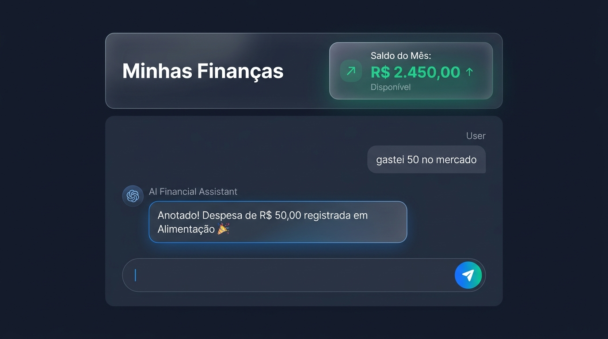
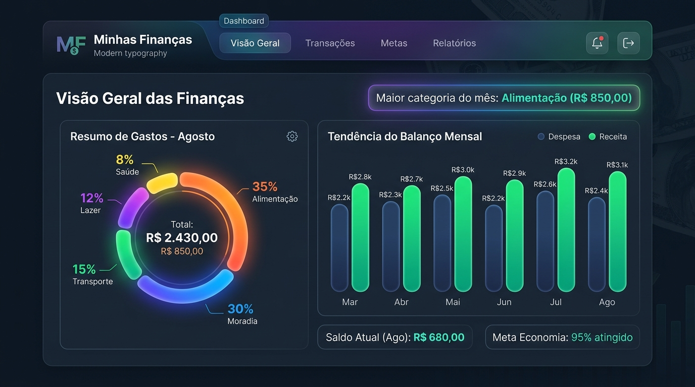
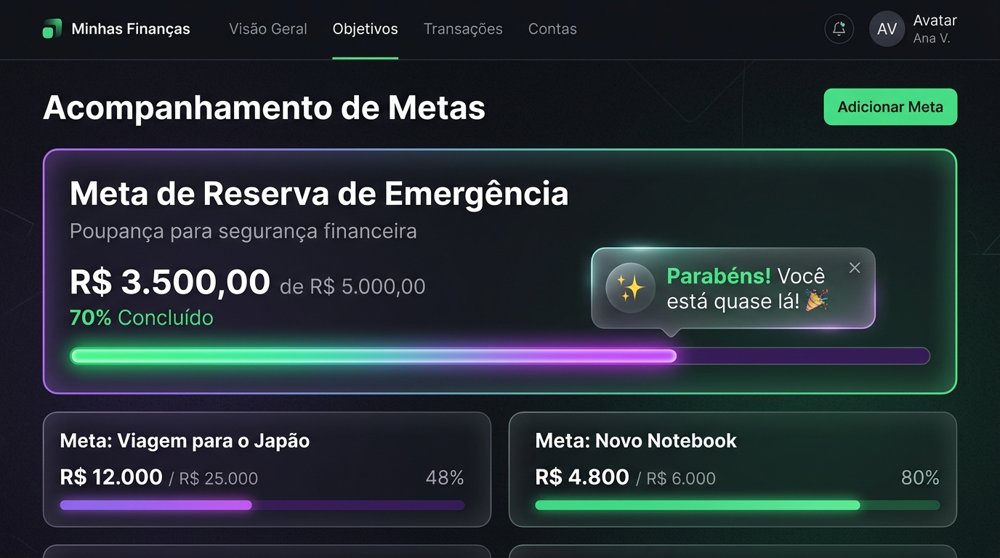

# 💸 App de Organização de Finanças Pessoais com Vibe Coding

> **Laboratório educacional DIO** — Aprenda a criar soluções com IA de forma criativa, guiando **Copilot** e **Lovable** com comunicação simples e natural podendo usar outras IA  de sua preferência.

---

## 📚 Índice Rápido

1. [O que é Vibe Coding](#-o-que-é-vibe-coding)
2. [Comece Aqui](#-comece-aqui-guia-rápido)
3. [O Desafio em 3 Etapas](#-o-desafio-em-3-etapas)
4. [Arquivos Importantes](#-arquivos-importantes)
5. [As 6 Fases do Projeto](#-as-6-fases-do-projeto)
6. [Exemplos Visuais](#-exemplos-visuais-de-cada-fase)
7. [Validação e Entrega](#-validação-e-entrega-na-dio)
8. [FAQ e Dúvidas](#-faq-e-dúvidas)

---

## ✨ O que é Vibe Coding

**Vibe Coding** é uma forma leve e criativa de desenvolver com IA, baseada em **conversas naturais e bem estruturadas**. Você não precisa escrever código linha por linha. Em vez disso, aprende a:

- ✅ **Comunicar claramente** sua visão para a IA
- ✅ **Validar incrementalmente** cada fase do projeto
- ✅ **Colaborar naturalmente** com ferramentas de IA (Copilot, Lovable)
- ✅ **Transformar ideias em soluções reais** sem escrever código manual

> **Regra de Ouro:** Você mostra a vibe da sua ideia e a IA transforma em solução (ou em um caminho para ela).

---

## 🚀 Comece Aqui: Guia Rápido

### Para Alunos da DIO

**Seu objetivo:** Construir um **App de Organização de Finanças Pessoais** apenas conversando com IA.

**Tempo estimado:** 4-6 horas (usando Lovable ou Copilot)

**Pré-requisitos:**

- Uma conta em [Lovable.ai](https://lovable.ai) OU acesso a [Copilot Web](https://copilot.microsoft.com)
- Este repositório aberto em outra aba
- Um pouco de paciência e criatividade! 🎨

**Próximo passo:** Leia [PRD.md](./PRD.md) — é seu briefing para a IA.

---

## 🎯 O Desafio em 3 Etapas

### **Etapa 1: Definir a Visão (30 min)**

Crie um **PRD (Product Requirements Document)** que descreva:

- **Problema:** Muitas pessoas desistem de controlar gastos porque apps são complexos
- **Solução:** Um app que controla finanças por **conversa simples**
- **Funcionalidades:** Chat → Registro → Classificação → Saldo → Metas → Dashboard

📄 **Use:** [PRD.md](./PRD.md) como referência e customize conforme sua visão.

> [!TIP]
> Pense no PRD como "o briefing que a IA precisa para entender sua vibe". Quanto mais claro, melhores as respostas!

### **Etapa 2: Construir com IA (2-4 horas)**

Siga as **6 fases** em `prompts/`, uma de cada vez:

1. **Fase 0** → UI base (título, cartão de saldo, chat)
2. **Fase 1** → Registro de gastos via conversa
3. **Fase 2** → Classificação automática + lista
4. **Fase 3** → Cálculos de saldo
5. **Fase 4** → Agente inteligente (metas + dicas)
6. **Fase 6** → Persistência e polimento

Cada fase tem:

- 📋 **Prompt principal** (cole no Lovable/Copilot)
- 🔧 **Refinamentos** (perguntas comuns para ajustar)
- ✅ **Checklist de aceite** (valide antes de avançar)

📄 **Use:** Pasta `prompts/fase-N-*.md`

### **Etapa 3: Entregar na DIO (30 min)**

Publique seu repositório (pode ser fork deste) com:

- ✅ Seu **PRD.md** personalizado
- ✅ Screenshots ou vídeos das interações com IA
- ✅ Resumo do que o app faz
- ✅ Reflexão: o que funcionou? O que aprendeu?

📄 **Siga:** Instruções em [Como Entregar](#como-entregar)

> [!IMPORTANT]
> **Você não precisa construir o código!** O foco é usar a IA como parceira criativa.

---

## 📁 Arquivos Importantes

| Arquivo                     | Propósito                                                 | Leitura               |
| --------------------------- | ---------------------------------------------------------- | --------------------- |
| **PRD.md**            | Documento de Requisitos do Produto — contexto persistente | 📖 Obrigatória (1ª) |
| **ARCHITECTURE.md**   | Arquitetura do app e organização do repositório         | 📖 Recomendada        |
| **AGENTS.md**         | Instruções para ferramentas de IA                        | 📖 Se usar Copilot    |
| **prompts/fase-*.md** | Prompts estruturados (0-6)                                 | 📖 Conforme avanço   |

---

## 🎮 As 6 Fases do Projeto

### **Fase 0: UI Base** ← Comece por aqui!

**Objetivo:** Montar a tela inicial do app

**Entregável:**

- Título "Minhas Finanças"
- Cartão "Saldo do mês" (zerado)
- Mensagem de boas-vindas do agente
- Campo de texto + botão enviar

**Tempo:** 15-20 min
**Prompt:** [prompts/fase-0-base.md](./prompts/fase-0-base.md)

**Checklist:**

- [ ] Título visível
- [ ] Cartão de saldo aparece
- [ ] Chat com boas-vindas
- [ ] Campo de entrada funciona

---

### **Fase 1: Chat e Registro**

**Objetivo:** IA entende transações em linguagem natural

**Entregável:**

- "gastei 50 no mercado" → registra despesa R$ 50,00
- "recebi 3500 de salário" → registra receita R$ 3.500,00
- Confirmação antes de salvar
- Lista de transações

**Tempo:** 20-30 min
**Prompt:** [prompts/fase-1-chat.md](./prompts/fase-1-chat.md)

**Checklist:**

- [ ] Entende despesas ("gastei", "paguei")
- [ ] Entende receitas ("recebi", "ganhei")
- [ ] Pede confirmação
- [ ] Lista atualiza

---

### **Fase 2: Classificação e Organização**

**Objetivo:** Transações são organizadas por categoria automaticamente

**Entregável:**

- Categorias: Alimentação, Moradia, Transporte, Lazer, Saúde, Outros
- Lista agrupada por dia
- Cores: despesa (vermelha), receita (verde)
- Resumo por categoria

**Tempo:** 20-30 min
**Prompt:** [prompts/fase-2-classificacao.md](./prompts/fase-2-classificacao.md)

**Checklist:**

- [ ] "mercado" → Alimentação
- [ ] "aluguel" → Moradia
- [ ] Lista ordenada por data
- [ ] Resumo de categorias correto

---

### **Fase 3: Cálculos e Saldo**

**Objetivo:** Saldo real do mês é calculado

**Entregável:**

- Saldo = Receitas - Despesas do mês
- Cartão mostra: Entradas, Saídas, Saldo
- Formato brasileiro: R$ 1.234,56
- Agente responde sobre gastos

**Tempo:** 15-20 min
**Prompt:** [prompts/fase-3-saldo.md](./prompts/fase-3-saldo.md)

**Checklist:**

- [ ] Saldo calcula correto
- [ ] Só mês atual é considerado
- [ ] Formato brasileiro
- [ ] Agente responde "qual meu saldo?"

---

### **Fase 4: Agente Inteligente**

**Objetivo:** IA dá dicas e acompanha metas

**Entregável:**

- "quero guardar 500 por mês" → cria meta
- Cartão de meta com progresso
- Dicas personalizadas sobre maior gasto
- Comemorações ao atingir meta

**Tempo:** 20-25 min
**Prompt:** [prompts/fase-4-agente.md](./prompts/fase-4-agente.md)

**Checklist:**

- [ ] Meta é criada e confirmada
- [ ] Progresso é visualizado
- [ ] Dicas citam categoria maior
- [ ] Comemoração funciona

---

### **Fase 5: Dashboard e Relatórios**

**Objetivo:** Visualização gráfica dos dados

**Entregável:**

- Aba "Dashboard"
- Gráfico de rosca por categoria
- Gráfico de barras (últimos 6 meses)
- Categoria campeã destacada
- Legenda com valores e %

**Tempo:** 20-30 min
**Prompt:** [prompts/fase-5-dashboard.md](./prompts/fase-5-dashboard.md)

**Checklist:**

- [ ] Duas abas funcionam (Conversa / Dashboard)
- [ ] Rosca mostra categorias
- [ ] Barras mostram histórico
- [ ] Legenda com %

---

### **Fase 6: Persistência e Polimento**

**Objetivo:** App está completo, funcional e responsivo

**Entregável:**

- Dados salvam em localStorage
- Botão "Limpar dados" com confirmação
- Validações de valores
- Responsividade (mobile funciona)
- Toast notifications
- Rodapé

**Tempo:** 15-20 min
**Prompt:** [prompts/fase-6-persistencia.md](./prompts/fase-6-persistencia.md)

**Checklist:**

- [ ] Recarrega página, dados continuam
- [ ] Responsivo no celular
- [ ] Validações funcionam
- [ ] Toasts aparecem/desaparecem

---

## 🎨 Exemplos Visuais de Cada Fase

Veja como o app deve ficar em cada fase. Acesse os arquivos de exemplo:

- 🎨 [Fase 0 - UI Base](./examples/fase-0-ui-base.html)
- 🎨 [Fase 1 - Chat e Registro](./examples/fase-1-chat.html)
- 🎨 [Fase 2 - Classificação](./examples/fase-2-classificacao.html)
- 🎨 [Fase 3 - Saldo](./examples/fase-3-saldo.html)
- 🎨 [Fase 4 - Agente](./examples/fase-4-agente.html)
- 🎨 [Fase 5 - Dashboard](./examples/fase-5-dashboard.html)
- 🎨 [Fase 6 - Final](./examples/fase-6-final.html)

> Abra qualquer arquivo `.html` em seu navegador para ver a aparência esperada.

---

## ✅ Validação e Entrega na DIO

### Antes de Entregar

Complete este **Checklist Final de Qualidade:**

```markdown
## ✅ Checklist Final

### Funcionalidade
- [ ] Conversa entende transações em linguagem natural
- [ ] Valores calculam correto (Saldo = Receitas - Despesas)
- [ ] Categorias são atribuídas automaticamente
- [ ] Metas funcionam e progresso é visível
- [ ] Dashboard mostra gráficos corretos
- [ ] Dados persistem ao recarregar

### UX/Design
- [ ] Tudo está em português
- [ ] Cores estão corretas (verde receita, vermelho despesa)
- [ ] Responsivo no celular
- [ ] Botões são clicáveis e rápidos
- [ ] Mensagens do agente são amigáveis

### Documentação
- [ ] README completo com descrição do app
- [ ] PRD.md customizado
- [ ] Screenshots de cada fase
- [ ] Reflexão sobre o processo

### Padrão DIO
- [ ] Licença MIT presente
- [ ] Repositório público
- [ ] Commit histórico limpo
- [ ] Link testável (clone e abre no navegador)
```

### Como Entregar

1. **Customize seu PRD.md**

   - Descreva suas escolhas e decisões
   - Deixe claro o problema e a solução
2. **Adicione screenshots**

   - Abra seu app no Lovable/Copilot
   - Capture telas de cada fase
   - Crie pasta `screenshots/` no repositório
3. **Escreva sua reflexão**

   - Crie `REFLEXAO.md` com:
     - ✅ O que funcionou bem?
     - ❌ O que não funcionou como esperado?
     - 🧠 O que aprendeu sobre Vibe Coding?
4. **Publique**

   - Commit final: `git commit -m "chore: entrega final DIO"`
   - Push para main
   - Copie o link do repositório
   - Cole na plataforma DIO

---

## 💬 FAQ e Dúvidas

### "Preciso saber programar?"

**Não!** O objetivo é aprender a comunicar com IA. A IA escreve o código.

### "Posso usar Copilot em vez de Lovable?"

**Sim!** Ambos funcionam. Lovable é visual (mais intuitivo). Copilot é via chat (mais controle).

### "E se a IA não entender meu prompt?"

Refine! Use os **Refinamentos** de cada fase. Seja mais específico ou quebre em pedaços menores.

### "Onde copio o prompt?"

Cada fase tem um bloco `prompt principal`. Cole inteiro no seu chat (depois de colar o PRD.md).

## 🖼️ Demonstração Visual do App (Screenshots em Funcionamento)

Abaixo estão as capturas de tela do produto gerado a partir do fluxo de Vibe Coding:

### 1. Interface de Chat & Registro de Transações

Interface conversacional moderna em tom escuro, exibindo o cartão de saldo consolidado e a interação fluida com o Agente Financeiro registrando lançamentos por linguagem natural.



### 2. Dashboard de Análise Financeira & Relatórios

Painel visual com gráfico de rosca por categorias (Alimentação, Moradia, Transporte, Lazer, Saúde), histórico dos últimos 6 meses e destaque da principal categoria de gastos.



### 3. Acompanhamento de Metas Financeiras

Painel de acompanhamento de metas de economia com barra de progresso em tempo real e notificações motivacionais do Agente Financeiro.



### "Quanto tempo leva?"

Realisticamente: **4-6 horas** se for pela 1ª vez. Pode ser mais rápido se praticar.

### "E se eu não conseguir completar todas as fases?"

Tudo bem! Você ainda aprende. Entregue o que conseguiu com sua reflexão.

### "Posso customizar o app?"

Claro! Mude cores, adicione features, mude o tom do agente. Isso é Vibe Coding!

### "Como faço para testar se funciona?"

- **Lovable:** Clica no play (há pré-visualização)
- **Copilot:** Rode `npm run dev` (se usar React/Next)

---

## 🏆 Casos de Sucesso

Exemplos de apps que saíram bem assim:

- ✅ App de TODO com IA
- ✅ Calculadora de finanças pessoais
- ✅ Planner de viagens
- ✅ Chat com documentos (RAG)

---

## 📚 Leitura Adicional

- 📖 [ARCHITECTURE.md](./ARCHITECTURE.md) — Arquitetura técnica do app
- 📖 [AGENTS.md](./AGENTS.md) — Contexto para IA
- 📖 [PRD.md](./PRD.md) — Requisitos completos

---

## 📞 Suporte

- ❓ **Dúvida sobre uma fase?** Leia os Refinamentos no arquivo `prompts/fase-N.md`
- ❓ **Copilot não entende?** Cole o PRD.md primeiro, depois a fase
- ❓ **Bugs?** Abra uma issue com a fase onde errou

---

## 📝 Licença

MIT © 2026 [Pedro Zeferino da Silva](https://github.com/PedroZef)

---

## 🚀 Vamos Começar?

1. Leia [PRD.md](./PRD.md)
2. Abra [Lovable.ai](https://lovable.ai) ou [Copilot Web](https://copilot.microsoft.com)
3. Cole o PRD completo no chat
4. Siga [prompts/fase-0-base.md](./prompts/fase-0-base.md)
5. Boa sorte! 🎨

---

**Feito com vibe coding 💜**
